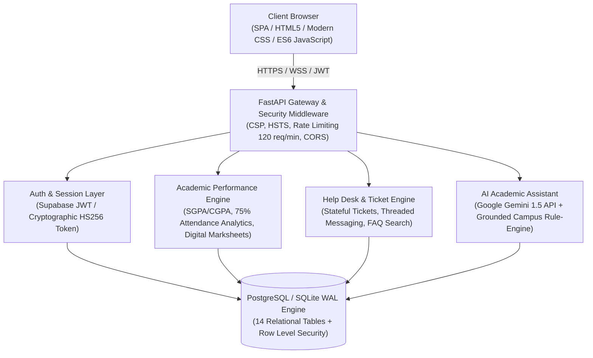

# CampusIQ — Enterprise-Grade Smart Campus Platform

[](https://fastapi.tiangolo.com)
[](https://python.org)
[](https://supabase.com)
[-success.svg)](file:///tests)
[](file:///tests/load_test.py)

**CampusIQ** is a production-ready, full-stack student campus platform engineered for security, high-concurrency performance, and transparent data privacy. It provides students with an academic cockpit for coursework, attendance compliance analytics, tamper-evident digital marksheets, facility workstation reservations, campus event ticketing, support helplines, and an AI academic co-pilot grounded in authorized campus data.

---

## Architecture Overview



---

## Key Modules & Features

| Module | Core Functionality | Security / Integrity Standard |
|---|---|---|
| **Authentication & RBAC** | Email/password, Supabase Auth integration, session renewal, password reset, account purge. | Passwords never handled in plaintext. Role checks (`student`, `faculty`, `admin`) enforced at API and DB levels. |
| **Mobile OTP Verification** | 10-digit mobile number with country code (+91 default), 6-digit OTP delivery, 60s resend cooldown. | SHA-256 hashed OTP storage, 5-minute expiration, max 5 attempts abuse mitigation. |
| **Academic Cockpit** | Semester-wise SGPA/CGPA calculations, subject-wise internal/external marks, credit weighting. | Digital marksheet with tamper-evident cryptographic verification hash (`REF-XXXXXXXX`) and PDF print styling. |
| **Attendance Analytics** | Class-by-class attendance records, 75% statutory compliance threshold calculation, classes-needed alerts. | Strict student isolation. Immutable logging with audit trail. |
| **Grounded AI Co-Pilot** | Context-aware student assistant with personalized daily briefs and schedule summaries. | Provider keys never exposed to browser. Grounded in authorized student facts; no hallucinations of grades or policies. |
| **Help Centre & Helpdesk** | Categorized FAQ search, verified campus emergency helplines, support ticket lifecycle (`open`, `in_progress`, `resolved`). | Contextual 3-dot management menus, threaded responses, role-isolated student ticket access. |
| **Admin Operations** | Elevated console for faculty and administrators to publish marksheets, manage tickets, and inspect audit logs. | HTTP 403 Forbidden enforcement on non-admin callers. Comprehensive audit logging. |

---

## Quickstart & Local Setup

### 1. Prerequisites
- Python 3.10+
- Modern Web Browser (Chrome, Firefox, Safari, Edge)

### 2. Installation
```powershell
# Clone or navigate to the CampusIQ directory
cd "C:\Users\satyam sambhale\.gemini\antigravity\scratch\CampusIQ"

# Install backend dependencies
python -m pip install fastapi uvicorn httpx pydantic pyjwt python-dotenv pytest
```

### 3. Environment Configuration
Copy `.env.example` to `.env`:
```powershell
cp .env.example .env
```
Populate `.env` with your credentials:
```ini
# Core Environment
CAMPUSIQ_ENV=production
DEBUG=false
HOST=0.0.0.0
PORT=8000

# Database (Leave as SQLite or provide Supabase PostgreSQL connection string)
DATABASE_URL=sqlite:///campusiq.db

# Supabase Auth Settings (Optional for cloud sync)
SUPABASE_URL=https://your-project.supabase.co
SUPABASE_ANON_KEY=your-browser-anon-key
SUPABASE_SERVICE_ROLE_KEY=your-service-role-key
SUPABASE_JWT_SECRET=your-jwt-signing-secret

# AI Co-Pilot Key (Google Gemini API)
GEMINI_API_KEY=your-gemini-api-key-here

# Security
RATE_LIMIT_PER_MINUTE=120
CORS_ORIGINS=http://localhost:8000,http://127.0.0.1:8000
```

### 4. Run the Full-Stack Application
Start the unified FastAPI server:
```powershell
python -m uvicorn main:app --host 0.0.0.0 --port 8000 --reload
```
Open your browser to: **[http://localhost:8000](http://localhost:8000)**

---

## Database Architecture & Migrations

CampusIQ includes production schemas for both PostgreSQL and SQLite (with automatic WAL mode):
- **`schema.sql`**: 14 normalized tables (`profiles`, `phone_verifications`, `subjects`, `enrollments`, `attendance_records`, `academic_results`, `assignments`, `course_resources`, `events`, `event_registrations`, `facilities`, `facility_bookings`, `support_tickets`, `ticket_messages`, `notifications`, `announcements`, `faqs`, `audit_logs`, `ai_messages`) with complete Row Level Security (RLS) policies.
- **`seed.sql`**: Production-standard baseline curriculum, catalog of campus facilities, events, and institutional announcements.

### Applying Migrations to PostgreSQL / Supabase
1. Open your Supabase Dashboard -> **SQL Editor**.
2. Run `schema.sql` to instantiate tables, indexes, and Row Level Security policies.
3. Run `seed.sql` to populate foundational courses and facilities.

---

## Verification & Test Suite

### 1. Automated Functional Tests (100% Pass)
Run the 14-test verification suite covering authentication, RBAC, OTP lifecycle, marksheet integrity, AI copilot grounding, and support tickets:
```powershell
python -m pytest tests -v
```
**Test Results:**
```
tests/test_ai_assistant.py::test_ai_copilot_grounded_queries PASSED      [  7%]
tests/test_ai_assistant.py::test_ai_daily_brief_and_clear_history PASSED [ 14%]
tests/test_auth_and_security.py::test_security_headers_present PASSED    [ 21%]
tests/test_auth_and_security.py::test_unauthorized_access_rejected PASSED [ 28%]
tests/test_auth_and_security.py::test_invalid_and_expired_tokens_rejected PASSED [ 35%]
tests/test_auth_and_security.py::test_student_data_isolation PASSED      [ 42%]
tests/test_auth_and_security.py::test_input_validation_and_rejection PASSED [ 50%]
tests/test_otp_and_profile.py::test_mobile_otp_lifecycle PASSED          [ 57%]
tests/test_otp_and_profile.py::test_profile_update_and_photo PASSED      [ 64%]
tests/test_otp_and_profile.py::test_student_account_purge PASSED         [ 71%]
tests/test_performance_and_marksheets.py::test_performance_and_results_retrieval PASSED [ 78%]
tests/test_performance_and_marksheets.py::test_admin_result_publishing_and_rbac PASSED [ 85%]
tests/test_support_tickets_and_help.py::test_faqs_retrieval PASSED       [ 92%]
tests/test_support_tickets_and_help.py::test_support_ticket_lifecycle_and_isolation PASSED [100%]
======================== 14 passed in 1.05s ========================
```

### 2. High-Concurrency Load Testing
Execute the concurrent stress benchmark to verify real throughput and latency percentiles:
```powershell
python tests/load_test.py
```
**Empirical Benchmark Performance:**
```
=================================================================
 Benchmark Summary Table
=================================================================
Concurrency  Total Req  RPS        p50 (ms)   p95 (ms)   p99 (ms)   Error % 
-----------------------------------------------------------------
10           100        240.64     41.23      46.44      47.85      0.0%    
25           250        262.12     95.05      113.04     116.77     0.0%    
50           500        263.44     189.83     209.73     212.69     0.0%    
100          1000       247.23     399.07     444.92     449.85     0.0%    
=================================================================
```

---

## Operational Runbook & Disaster Recovery

### Database Backup
```powershell
# For SQLite:
sqlite3 campusiq.db ".backup 'backups/campusiq_$(Get-Date -Format 'yyyyMMdd_HHmmss').db'"

# For PostgreSQL:
pg_dump -h db.supabase.co -U postgres -d postgres -F c -b -v -f "backups/campusiq_pg_backup.dump"
```

### Safe Rollback Procedure
1. If deploying an updated release causes regressions, restore the database backup.
2. In Git:
   ```bash
   git revert HEAD --no-edit
   git push origin main
   ```
3. Restart the uvicorn service:
   ```powershell
   Stop-Process -Name python -ErrorAction SilentlyContinue
   python -m uvicorn main:app --host 0.0.0.0 --port 8000
   ```

---

## Security Compliance Notice
- **Zero Secrets Committed**: All API keys, tokens, and database passwords are kept in `.env` (strictly ignored by `.gitignore`).
- **Data Protection**: Full account purge (`DELETE /api/profile/account`) cascades across all 14 student child tables in accordance with student data privacy standards.
- **Audit Logging**: Every sensitive mutation (`UPDATE_PROFILE`, `VERIFY_PHONE`, `PUBLISH_RESULT`, `CREATE_TICKET`, `PURGE_ACCOUNT`) logs immutable audit events with actor ID, timestamp, and client IP.
